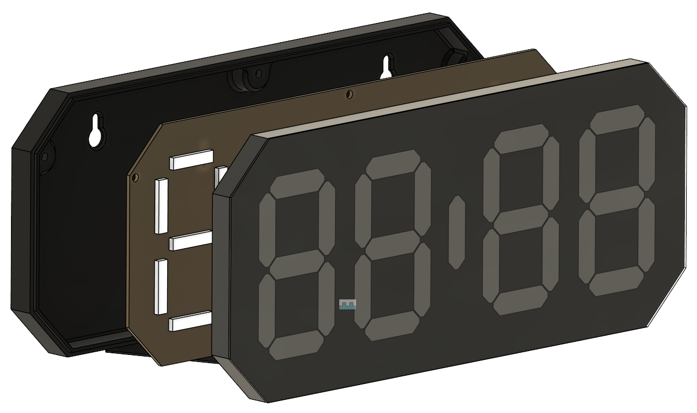

# LEDClock

A DIY 4-digit 7-segment clock built from WS2812B / SK6812 LED strips in a 3D-printed case, driven by an ESP32 running [ESPHome](https://esphome.io/).



## Features

- `HH:MM` display rendered by the [addressable_light_digital_display](https://github.com/daweizhangau/esphome_addressable_light_digital_display) external component. Colon blinks at 1 Hz once the time comes from a real source.
- Boot IP splash: once WiFi connects (or the fallback hotspot starts), the display shows `IP:` and then each octet of the device's IPv4 address. Each screen holds 3 s with 0.5 s dark between screens, and the sequence runs twice (35 s), then the time returns. Until WiFi is up (a few seconds after boot) the clock shows the time. Runs once per boot.
- Auto brightness that follows the sun: a linear ramp from night to day brightness between two sun elevations (defaults: 15% at -6°, 40% at +10°), re-evaluated every 60 s. Toggle with the "Auto Brightness" switch.
- Timekeeping from any one of three real sources:
  1. NTP over WiFi (servers `0-2.us.pool.ntp.org`, hardcoded in `clock-common.yaml`).
  2. Optional battery-backed PCF8563T RTC module: seeds the clock at boot, rewritten on every NTP sync and manual set.
  3. Manual "Set Date & Time", "Time Zone" and "UTC Offset" controls in the web UI or Home Assistant, for sites without NTP.

  Display-only fallback for clocks without an RTC: the last known time reaches flash at most once a minute. After a power cycle the clock shows that time plus uptime, with a steady colon, until a real source is available. The estimate is stale by the power-off time, so Home Assistant and auto brightness ignore it. A freshly flashed clock with no source stays blank.
- Runtime time zone selection (US, UK, Central/Eastern Europe, UTC or a fixed offset) with DST rules, stored in flash.
- Local web UI at `http://<device-ip>/` (digest auth, assets embedded so it works offline), Home Assistant API, OTA updates, fallback WiFi hotspot with captive portal.

## Hardware

| Part | Notes |
| --- | --- |
| ESP32 board | Package default `esp32-c6-devkitc-1`; `esp32-clock.yaml` uses a Seeed XIAO ESP32-C5. ESP-IDF framework. |
| LED strip | WS2812B or SK6812 RGB (not RGBW), GRB. Default layout: 116 LEDs, 4 LEDs per segment, 4 separator LEDs (`:..:`), strip wired right-to-left. Needs a 5 V supply sized for the LED count; the YAML sets no current limit. The 3.3 V data line may need a level shifter on some strips. |
| PCF8563T RTC module (optional) | I2C address `0x51`. Power - check particular module requirement **3V vs 5V**. |

Default pins: LED data `GPIO4`, I2C SDA `GPIO6`, SCL `GPIO7`. They suit the ESP32-C6 DevKitC-1 only, so change `board` and the pins together. For example, `esp32-clock.yaml` (XIAO ESP32-C5, no RTC package) uses `GPIO0` for LED data.

## Schematics

Wall clock schematic, Rev B002: [`media/WALL_CLOCK_SCH_Rev_B002.pdf`](media/WALL_CLOCK_SCH_Rev_B002.pdf).

## 3D model

Printable case: [`3D-Model/Clock.3mf`](3D-Model/Clock.3mf).

_TODO: parts list, print settings, filament, assembly notes._

## Repository layout

```
3D-Model/Clock.3mf          printable case
media/                      pictures, schematic (PDF)
esphome/
  clock-common.yaml         shared package: display, brightness, time, web UI, all entities
  clock-rtc-pcf8563.yaml    optional add-on package for clocks with the PCF8563T RTC
  esp32-clock.yaml          example device file: substitutions + package includes
  secrets.yaml-sample.txt   template for secrets.yaml (git-ignored)
```

## Setup

1. Install ESPHome 2026.9.0 or newer (`pip install esphome`, or the Home Assistant add-on). The first compile fetches the display component from GitHub, so it needs `git` and internet access.
2. Copy `esphome/secrets.yaml-sample.txt` to `esphome/secrets.yaml` and fill in your values, including `latitude` and `longitude` (decimal degrees) for the sun-based brightness. Generate `api_key` with `openssl rand -base64 32`.
3. Create a device file (or edit `esp32-clock.yaml`):

   ```yaml
   substitutions:
     device_name: kitchen-clock
     friendly_name: "Kitchen Clock"
     board: esp32-c6-devkitc-1
     led_pin: GPIO4
     # api_reboot_timeout: 0s   # set this if the clock runs without Home Assistant

   packages:
     common: !include clock-common.yaml
     rtc:    !include clock-rtc-pcf8563.yaml   # only if the RTC module is fitted
   ```

   Every substitution at the top of `clock-common.yaml` can be overridden here: LED count, `led_map`, `strip_reverse`, day/night brightness and elevations, I2C pins, `api_reboot_timeout`. For the time zone, set `timezone` (tz database name) and `tz_default_option` (exact "Time Zone" option string) to the same zone. `tz_default_option` applies only on first boot; after that the clock keeps its stored zone.
4. Validate, then flash (first time over USB, OTA afterwards):

   ```bash
   esphome config esphome/esp32-clock.yaml
   ```

   ```bash
   esphome run esphome/esp32-clock.yaml
   ```

   View the log later with `esphome logs esphome/esp32-clock.yaml`.

## Usage notes

- **Without NTP:** open the web UI, set "Time Zone" first, then "Set Date & Time" (the entered time is read in the selected zone). "UTC Offset" applies only when the zone is "Fixed UTC offset"; edits made under a named zone are reverted.
- **Manual brightness:** turn "Auto Brightness" off, then set the brightness of the "Digital Clock" light. While auto is on, a manual change lasts until the sun ramp next changes the computed brightness.
- **Without Home Assistant:** set `api_reboot_timeout: 0s`, otherwise the clock reboots every 15 minutes when no API client connects.
- **Custom LED layout:** `led_map` lists the segment letter for each LED in strip order, groups separated by spaces (spaces map to no LED), `:` for colon LEDs and `.` for decimal-point LEDs (lit only when the displayed text contains `.`). Segment letters follow the standard A–G convention (A top, clockwise, G middle); the comment in the `display:` block of `clock-common.yaml` maps them to the other numbering schemes used in this project.
- **RTC check:** with the RTC package, the boot log should show `Found i2c device at address 0x51`. "RTC halted" means first boot or a dead battery.

## License

[CC BY-NC-SA 4.0](https://creativecommons.org/licenses/by-nc-sa/4.0/): free for personal, non-commercial use with attribution; derivatives must use the same license. See [LICENSE](LICENSE).

**Commercial use** (selling clocks, kits, prints or the design) needs the author's permission. Contact [Author](https://github.com/vladm) or open an issue.

Firmware compiled from this configuration includes ESPHome, whose C++ runtime is GPL-3.0; that license still applies to the binaries.
